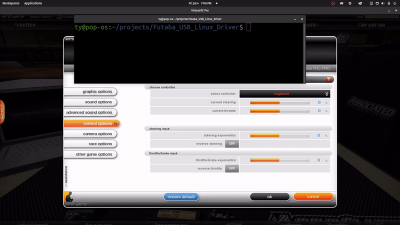

# Futaba RC USB Driver

A high-performance Linux driver for Futaba RC USB receivers that creates virtual joystick devices for RC flight simulators and games.

### What This Does

Plug in your Futaba USB receiver, run this driver, and it shows up as a joystick in your flight simulator or game. Works with popular simulators like RealFlight, Phoenix, and others that support joysticks.



### Supported Devices

- Futaba WSC-1
- Futaba T16IZ
- Other Futaba USB receivers with HID interface

### Installation

#### Quick Install (Recommended)
```bash
wget {{distributables_path}}/{{web_install_script_name}}
chmod +x {{web_install_script_name}}
./{web_install_script_name}
```

#### Manual Install
1. Download and extract the latest release
2. Run the installer: `./{{install_script_name}}`
3. The driver starts automatically when you log in

#### Steam Deck
The quick installer automatically detects Steam Deck and configures everything for Desktop Mode compatibility.

### Using the Driver

Once installed, the driver runs automatically in the background. Just plug in your Futaba receiver and start your simulator.

To check if it's working:
```bash
{{exectuable_name}} --help
```

### Calibration

The driver works out of the box with default settings, but you can fine-tune it for your specific transmitter.

#### When to Calibrate
- Controls don't reach full range in your simulator
- Center positions are off
- Some channels are reversed

#### How to Calibrate
1. Stop the driver: `pkill futaba-driver`
2. Start calibration mode: `futaba-driver --calibrate`
6. Follow the on-screen prompts to completion
7. Restart the driver

### Troubleshooting

#### Driver won't start
```bash
# Check if your device is detected
lsusb | grep -i futaba

# Try running with elevated permissions
sudo {{executable_name}}
```

#### No input in simulator
1. Check that virtual joystick was created: `ls /dev/input/by-id/*futaba*`
2. Test with a joystick testing program
3. Recalibrate if controls seem off

#### Steam Deck specific issues
- Make sure you're in Desktop Mode
- Try restarting after installation
- Check logs: `cat ~/.futaba-driver-logs.txt`

### Uninstalling

Run the uninstaller from your installation directory:
```bash
{{install_dir}}/{{uninstall_script_name}}
```

---

## For Developers

### Project Overview

This is a multi-process Python application that creates virtual input devices using the Linux uinput subsystem. Each connected Futaba device runs in its own process for real-time performance.

### Architecture

- **Driver.py**: Main device driver with subprocess management
- **Manager.py**: Multi-device coordination  
- **InputChannel.py**: Calibration system with O(1) lookup tables
- **Worker.py**: Real-time input processing loop (runs in separate process)
- **Util.py**: USB device discovery and utility functions

### Development Setup

```bash
git clone {{repository}} {{executable_name}}
cd {{exectuable_name}}
python3 -m venv .venv
source .venv/bin/activate
pip install .
```

### Testing During Development

**Always use `run.sh` for development testing:**
```bash
sudo ./run.sh
sudo ./run.sh --help
```

**Why `run.sh` vs other methods:**

- **`run.sh`**: Development script that activates the venv and includes dependency validation. Catches environment issues that could cause discrepancies between dev and production.

- **Production wrapper** (generated by build): Self-contained executable with bundled dependencies. No Python interpreter required.

- **Never run `python main.py` directly**: Bypasses important environment checks that could hide dependency problems.

### Building and Packaging

Build scripts use shebang to the venv Python interpreter and must be run as executables:

```bash
# Build standalone executable
./build.py

# Create distribution package  
./package.py

# Clean all genrated artifacts
./clean.py

# Clean build artifacts
./clean.py --build

# Clean package artifacts
./clean.py --package
```

### Code Organization

#### Real-time Performance Requirements
- Input processing loop must maintain O(1) performance
- Calibration uses pre-computed lookup tables to avoid runtime calculations
- Each device runs in separate process with real-time priority

#### Memory Management
- Calibration tables consume ~13KB per channel
- Tables are generated once at startup, not per-frame
- Shared memory used for inter-process communication

### Testing

1. **Development testing**: Use `sudo ./run.sh` to catch environment issues
2. **Production testing**: Build and test the standalone executable
3. **Multi-device testing**: Test with multiple receivers if available
4. **Steam Deck testing**: Verify user-space installation works

### Contributing

1. **Fork and branch**: Create feature branch from main
2. **Environment**: Always develop using `./run.sh`
3. **Testing**: Test both development and built versions
4. **Performance**: Profile any changes to input processing paths
5. **Documentation**: Update user sections if adding user-facing features

### Pull Request Guidelines

1. Test with `./run.sh` during development
2. Build and test final executable
3. Verify no regressions in input latency
4. Include tests for new functionality
5. Update documentation for user-facing changes

### Project Structure

```
src/
├── main.py              # Entry point
├── Futaba/
│   ├── Driver.py        # Device driver class
│   ├── Manager.py       # Multi-device manager
│   ├── InputChannel.py  # Calibration system
│   ├── Worker.py        # Input processing loop
│   └── Util.py         # Utilities and USB discovery
├── build.py            # Build standalone executable
├── package.py          # Create distribution packages
└── clean.py           # Clean build artifacts
```

### Technical Notes

#### USB Device Detection
Uses PyUSB to enumerate devices and find interrupt endpoints. Supports hot-plug detection.

#### Input Processing
- Reads raw USB interrupt data
- Applies calibration via lookup table
- Emits to virtual uinput device
- Processes hundreds of updates per second

#### Calibration System
- Pre-computes all possible input->output mappings
- Stores as array where index=raw_value, value=calibrated_output
- Supports per-device and per-channel calibration
- Handles min/center/max point interpolation

#### Multi-Process Design
- Main process handles device management
- Worker processes handle real-time input (one per device)  
- IPC via multiprocessing.Pipe for control/status
- Real-time scheduling for input processes

### Dependencies

- **PyUSB**: USB device access
- **python-uinput**: Virtual input device creation
- **Nuitka**: Build system for standalone executables

### Platform Support

- Linux x86_64 (primary target)
- Steam Deck / SteamOS (user-space installation)
- Requires kernel uinput support