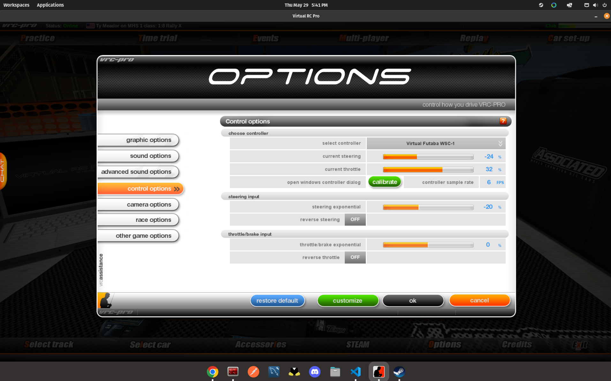

# Futaba USB RC Linux Driver 

Python script that will remap the native hardware inputs to a virtual joystick device. This allows most windows games to play nicely with your hardware on Linux. In theory this should "just work" if any Futaba USB RC adapter but I've only tested with the Futaba WSC-1 on VRC-Pro

This repo is inspired by [dji-mini-controller-linux-driver](https://github.com/catrielmuller/dji-mini-controller-linux-driver).

## Installation and Use

### Commands
NOTE: The driver requires root level access which means you must be a sudoer!
```
git clone https://gitlab.com/Native-Coder/futaba-usb-rc-linux-driver.git # Clone this repo
cd futaba-usb-rc-linux-driver                                            # Change working directory to the repo you just cloned
sudo pip3 install -r requirements.txt                                    # install dependencies
sudo python3 main.py                                                     # start the driver
```
Leave this terminal running and launch the RC sim of your choice. Your device should show up as `Virtual {futaba_device_name}`

## Issues and Contributing
If you encounter any issues:
- [please create an issue](https://gitlab.com/Native-Coder/futaba-usb-rc-linux-driver/-/issues/new)
- I need help verifying other Futaba products - [please create an issue](https://gitlab.com/Native-Coder/futaba-usb-rc-linux-driver/-/issues/new) if you think you can help with this!
- I will respond as soon as I am able

## Known Compatability Chart
| Futaba Device                                 | Game                                                          | Supported | 
| --------------------------------------------- | ------------------------------------------------------------- | --------- |
| [WSC-1](https://futabausa.com/product/wsc-1/) | [VRC-Pro](https://store.steampowered.com/app/335070/VRC_PRO/) |  &check;  |