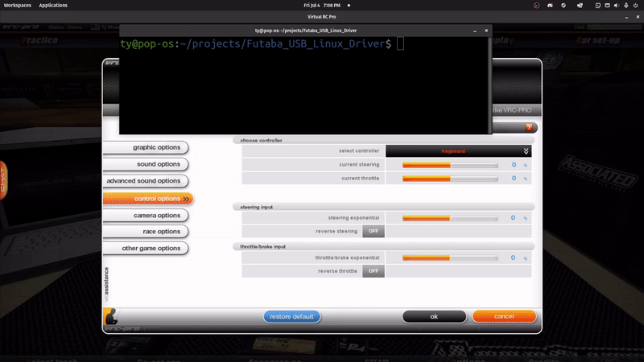

# Futaba RC USB Driver - Standalone Distribution



A high-performance Linux driver for Futaba RC USB receivers, providing low-latency joystick input for simulators and games.

## Quick Install

```sh
# The quick install script will automatically
# download the latest release and install it.
wget {{distributables_path}}/{{web_install_script_name}}
chmod +x {{web_install_script_name}}
./{{web_install_script_name}}
```

## What's Included

- `{{executable_name}}` - Main executable (requires sudo for uinput access)
- `{{install_script_name}}` - System installer script
- `README.md` - This file
- `LICENSE` - License information
- `NOTICE` - Third-party notices
- `udev.rules` - USB device permissions

## System Requirements

- Linux x86_64
- Kernel 3.0+ with uinput support
- USB permissions for your user (or run as sudo)
- Python 3.11+ (for development only)

## Supported Devices

- Futaba WSC-1
- Futaba T16IZ
- Other Futaba USB receivers (auto-detected)

---

## Installation

### Manual Installation

1. **Download the latest release:**
   ```sh
   wget {{distributables_path}}/{{executable_name}}-{{version}}-linux-x86_64.tar.gz
   tar -xzf {{executable_name}}-{{version}}-linux-x86_64.tar.gz
   cd {{executable_name}}-{{version}}-linux-x86_64
   ```

2. **Run the installer:**
   ```sh
   ./{{install_script_name}}
   ```
   
   The installer will:
   - Copy files to `~/.local/share/{{executable_name}}/`
   - Create a symlink in `~/.local/bin/`
   - Set up USB permissions (requires sudo)
   - Add user to `input` group (requires sudo)
   - Configure uinput module to load at boot
   - Add auto-start to your shell profile
   - Run initial calibration

3. **Log out and back in** for group changes to take effect

### Steam Deck Installation

The installer automatically detects Steam Deck and uses optimized settings:
- Installation survives SteamOS updates (user-space install)
- Works best in Desktop Mode
- Configures as user service

```sh
# In Desktop Mode (Konsole)
wget {{distributables_path}}/{{web_install_script_name}}
chmod +x {{web_install_script_name}}
./{{web_install_script_name}}
```

---

## Uninstallation

```sh
cd ~/.local/share/{{executable_name}}/
./uninstall.sh
```

The uninstaller will:
- Stop all running driver instances
- Remove the command from PATH
- Remove auto-start entries from shell profiles
- Remove installation directory
- Remove USB permissions and udev rules
- Remove uinput module configuration
- Clean up log files

**Note:** User group membership (input group) is preserved. You may want to log out and back in to refresh your environment.

---

## Usage

### Basic Commands

```sh
# Run the driver manually
sudo {{executable_name}}

# Calibration mode (interactive)
sudo {{executable_name}} --calibrate

# Run as background daemon
sudo {{executable_name}} --daemonize

# Display help
{{executable_name}} --help

# Show version
{{executable_name}} --version
```

### Auto-start

The driver is configured to start automatically when you log in. It runs continuously in the background and prevents duplicate instances.

**Manual control:**
```sh
# Stop the driver
pkill -f {{executable_name}}

# Check if running
pgrep -f {{executable_name}}
```

### Steam Deck Service Management

```sh
# Start service
systemctl --user start {{executable_name}}

# Enable auto-start with session
systemctl --user enable {{executable_name}}

# Check status
systemctl --user status {{executable_name}}

# View logs
journalctl --user -u {{executable_name}} -f

# Stop service
systemctl --user stop {{executable_name}}
```

---

## Troubleshooting

### Permission Denied
- Make sure you're running with sudo: `sudo ./{{executable_name}}`
- Or add your user to input group: `sudo usermod -a -G input $USER`
- Log out and back in for group changes to take effect

### Device Not Detected
- Check USB connection: `lsusb | grep Futaba`
- Try a different USB port
- Check kernel logs: `dmesg | tail -20`
- Verify USB permissions: `ls -l /dev/bus/usb/*/*`

### uinput Module Not Found
```bash
# Load the module manually:
sudo modprobe uinput

# Make it permanent:
echo 'uinput' | sudo tee -a /etc/modules

# Or (for systemd-based systems):
echo 'uinput' | sudo tee /etc/modules-load.d/uinput.conf
```

### Calibration Issues
- Ensure transmitter is bound to receiver before calibration
- Move all sticks and switches through their full range during calibration
- Recalibrate if you experience drift: `sudo {{executable_name}} --calibrate`

### Still Having Issues?
1. Check the log file: `cat ~/.{{executable_name}}-logs.txt`
2. Ensure no other drivers are conflicting
3. Verify udev rules are loaded: `sudo udevadm control --reload-rules && sudo udevadm trigger`

---

## Performance Notes

- Optimized for real-time RC applications (O(1) frame processing)
- Low latency, high precision input processing
- Minimal CPU overhead
- Supports multiple simultaneous receivers

---

## Developer Guide

### Getting Started

#### Prerequisites
- Linux x86_64 system
- Python 3.11 or higher
- GCC or Clang compiler
- Make utility
- Git (optional, for version tracking)

#### Initial Setup

1. **Clone or download the repository:**
   ```sh
   git clone {{repository}}
   cd futaba-usb-driver
   ```

2. **Create and activate virtual environment:**
   ```sh
   python3 -m venv .venv
   source .venv/bin/activate
   ```
   
   **Important:** All development scripts require the virtual environment to be active. The scripts will refuse to run if not in a venv.

3. **Install dependencies:**
   ```sh
   pip install .
   ```

4. **Install build tools:**
   ```sh
   pip install nuitka
   ```

5. **Install system dependencies:**
   ```sh
   # Ubuntu/Debian
   sudo apt install build-essential python3-dev libusb-1.0-0-dev

   # Arch/Manjaro
   sudo pacman -S base-devel python libusb
   ```

#### Project Structure

```
futaba-usb-driver/
├── src/
│   ├── main.py                 # Entry point
│   ├── Futaba/                 # Core driver package
│   │   ├── Driver.py           # Main driver logic
│   │   ├── Manager.py          # Device management
│   │   ├── InputChannel.py     # Channel processing
│   │   ├── configs/            # Device configurations
│   │   └── calibrations/       # Calibration profiles
│   ├── UI/                     # User interface
│   │   ├── Calibration.py      # Calibration UI
│   │   ├── Menu.py             # Menu system
│   │   └── Window.py           # Window management
│   └── SocketLock.py           # Instance locking
├── tools/                      # Build system
│   ├── build.py                # Build script
│   ├── package.py              # Packaging script
│   ├── clean.py                # Cleanup script
│   ├── __config__.py           # Configuration
│   ├── util.py                 # Utilities
│   └── artifact-templates/     # Install script templates
├── pyproject.toml              # Project metadata
├── makefile                    # Convenience commands
└── README.md                   # This file
```

### Development Workflow

#### Using Make (Recommended)

The project includes a `makefile` with convenient targets. **Note:** The venv must be active for these to work.

```sh
# Build executable only
make build

# Build and package distribution
make package

# Clean all build artifacts
make clean

# Clean only build artifacts
make clean-build

# Clean only package artifacts
make clean-package

# Run the driver directly from source (for testing)
make run

# Complete build workflow (clean, build, package)
make all
```

#### Using the Wrapper Script

The `run.sh` wrapper script allows you to run the driver from source without activating the venv manually:

```sh
./run.sh                    # Run driver
./run.sh --calibrate        # Run calibration
./run.sh --help             # Show help
```

**How it works:** The wrapper automatically sources the venv, runs the main.py script with your arguments, then deactivates the venv when done.

**When to use:**
- Quick testing during development
- Running the driver without building
- Debugging with source-level visibility

**When NOT to use:**
- For production deployments (use the built executable)
- When testing the actual built binary
- In automated scripts (use the venv directly)

#### Manual Script Execution

If you prefer to run scripts directly:

```sh
# Activate venv first!
source .venv/bin/activate

# Then run any script
./tools/build.py
./tools/package.py
./tools/clean.py

# Deactivate when done
deactivate
```

### Build System Details

#### Build Process (`build.py`)

Creates a standalone executable using Nuitka:

```sh
# Basic build
./tools/build.py

# Clean before building
./tools/build.py --clean
```

**What it does:**
1. Validates environment (Python version, compiler, Nuitka)
2. Installs project dependencies
3. Locates native libraries (.so files) in venv
4. Compiles Python to C, then to native binary
5. Bundles all dependencies into `build/` directory
6. Creates wrapper script for execution
7. Tests the executable

**Configuration:** Settings are defined in `pyproject.toml` under `[tool.build_tool]`:
- `build_dir`: Output directory for built executable
- `executable_name`: Name of the final binary
- `install_dir`: Default installation path
- `native_dependencies`: Libraries to bundle

#### Packaging (`package.py`)

Creates distribution archives ready for release:

```sh
# Create packages
./tools/package.py

# Clean before packaging
./tools/package.py --clean
```

**What it does:**
1. Extracts version from git tags (or uses default)
2. Creates distribution directory structure
3. Copies executable, docs, and scripts
4. Renders template files (install.sh, README.md, etc.)
5. Creates tar.gz and tar.xz archives
6. Generates SHA256 checksums
7. Creates web installer script

**Output:** `dist/{{executable_name}}-X.Y.Z-linux-x86_64/`
- Compressed archives (.tar.gz, .tar.xz)
- Checksums (.sha256 files)
- Web installer ({{web_install_script_name}})
- Full installation package

#### Cleanup (`clean.py`)

Removes generated artifacts:

```sh
# Clean everything
./tools/clean.py

# Selective cleaning
./tools/clean.py --build          # Build artifacts only
./tools/clean.py --package        # Package artifacts only
./tools/clean.py --pycache        # Python cache files
./tools/clean.py --empty-log-dir  # Log files
```

### Template System

The build system uses Jinja2-style templates in `tools/artifact-templates/`:

**Template syntax:**
```sh
# In template file:
{{variable_name}}

# Gets replaced with actual values from __config__.py
```

**Key templates:**
- `scripts/install.sh` → Installation script
- `scripts/uninstall.sh` → Removal script  
- `scripts/web-installer.sh` → Quick web installer
- `scripts/wrapper.sh` → Executable wrapper
- `README.md` → Distribution README
- `VERSION` → Version information file

### Configuration Management

All build configuration is centralized in `tools/__config__.py`, which loads settings from `pyproject.toml`.

**Key settings:**
```python
BUILD_DIR          # Where executable is built
PACKAGE_DIR        # Where distribution is packaged
EXECUTABLE_NAME    # Name of the binary
INSTALL_DIR        # Default installation path
VERSION            # Project version
```

**Adding new configuration:**
1. Add to `pyproject.toml` under `[tool.build_tool]`
2. Import in `__config__.py`
3. Use in build/package scripts

### Testing Builds

```sh
# Test the built executable
./build/{{executable_name}} --version
./build/{{executable_name}} --help

# Test with sudo (required for uinput)
sudo ./build/{{executable_name}}

# Test calibration mode
sudo ./build/{{executable_name}} --calibrate
```

### Version Management

Versions are tracked in `pyproject.toml`:

```toml
[project]
version = "1.2.3"
```

The packaging script attempts to extract the version from git tags:
```sh
git describe --tags --always --dirty
```

Format: `v1.2.3` or `v1.2.3-5-gabcdef` (with commits ahead)

### Common Development Tasks

#### Adding a new device configuration

1. Create config file: `src/Futaba/configs/_DEVICE_NAME.json`
2. Create calibration file: `src/Futaba/calibrations/_DEVICE_NAME.json`
3. Add device detection logic in `src/Futaba/Manager.py`

#### Modifying the installer

1. Edit template: `tools/artifact-templates/scripts/install.sh`
2. Add any new variables to the template rendering in `package.py`
3. Test with `make package`

#### Changing installation paths

1. Update `pyproject.toml` → `[tool.build_tool]`
2. Rebuild: `make clean build package`
3. Test installation in a clean environment

### Release Checklist

1. Update version in `pyproject.toml`
2. Update CHANGELOG (if exists)
3. Run full build: `make clean all`
4. Test executable: `./build/{{executable_name}} --version`
5. Test installation: `./dist/*/{{install_script_name}}`
6. Create git tag: `git tag v1.2.3`
7. Upload distribution files to release page

### Troubleshooting Development Issues

**Nuitka compilation fails:**
- Ensure C compiler is installed
- Check Python version (3.11+ required)
- Try `make clean` then rebuild

**Scripts refuse to run:**
- Activate venv: `source .venv/bin/activate`
- Check Python version in venv: `python --version`

**Missing dependencies:**
- Reinstall: `pip install .`
- Check for system libraries: `ldconfig -p | grep usb`

**Template rendering issues:**
- Verify template syntax (double braces)
- Check variable names in `__config__.py`
- Look for typos in template files

---

## Support

For issues, updates, and documentation visit:
{{repo_url}}

---

Built with ❤️ for the RC community
